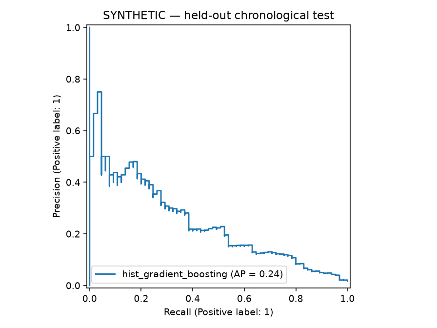

# Sentinel ML

**Fraud detection from chronological evaluation to an observable prediction API.**

A CPU-first ML engineering portfolio project built for an Apple M1 with 8 GB RAM.
It includes two classifiers, a cost-aware decision policy, strict data contracts,
versioned artifacts, a FastAPI service, drift analysis, automated tests, and GitHub Actions.



> The included results use synthetic transactions and verify the engineering workflow.
> They are **not evidence of real-world fraud detection performance**. Run the public-data
> workflow below before making dataset-specific claims in your portfolio.

## Why this problem

A fraud team has limited review capacity. Accuracy is misleading when fraud is rare;
the useful question is how much fraud a model identifies at an acceptable review cost.
Sentinel compares a scaled logistic regression baseline with histogram gradient boosting,
and chooses a validation policy minimizing `5 × false positives + 250 × false negatives`
under a 2% alert-rate constraint. Those costs are illustrative assumptions, not business estimates.

## Start on macOS

Use native ARM64 Python 3.11 or 3.12. A GPU, cloud account, and Docker are optional.

```bash
python3 -m venv .venv
source .venv/bin/activate
python -m pip install --upgrade pip
python -m pip install -e '.[dev]'
export OMP_NUM_THREADS=2
export OPENBLAS_NUM_THREADS=2
make demo
make test
make serve
```

Visit http://127.0.0.1:8000/docs for the interactive API. In another terminal:

```bash
curl http://127.0.0.1:8000/health
curl -X POST http://127.0.0.1:8000/predict \
  -H 'Content-Type: application/json' \
  --data-binary @artifacts/demo/request.json
curl http://127.0.0.1:8000/metrics
```

The generated `request.json` has 28 PCA features and an amount from one held-out
transaction. The response contains a model fingerprint, score, and review decision.
The score is not claimed to be a calibrated probability. Request batches are limited
to 1,000 transactions. Extra fields, malformed feature counts, invalid numeric values,
and duplicate IDs within a batch are rejected. Amount is limited to 1 billion and each
PCA feature to ±1 million to bound arithmetic; these are service input limits, not learned fraud rules. IDs are not persisted or deduplicated across requests.

`make demo` preserves existing runs and fails if `artifacts/demo` is nonempty.
For another experiment, pass a new `--out` directory instead of overwriting results.

## Use the public dataset

Obtain the original **Credit Card Fraud Detection** dataset from
[ULB / Machine Learning Group on Kaggle](https://www.kaggle.com/datasets/mlg-ulb/creditcardfraud).
It contains 284,807 transactions and 492 fraud cases across two days in September 2013.
Verify the current dataset license and access terms at the source. The MIT license in
this repository covers code only; no public dataset is redistributed here.

Place `creditcard.csv` in `data/`. It must contain `Time`, `V1` through `V28`,
`Amount`, and `Class`. No credentials or paid APIs are needed by the code.

```bash
sentinel train --csv data/creditcard.csv --out artifacts/public-001 --source public
MODEL_PATH=artifacts/public-001/model.joblib uvicorn sentinel.api:app --port 8000
```

The original dataset can contain exact duplicate rows. The loader deliberately rejects
them rather than silently deciding whether they represent repeated events. Inspect them,
then, if you document a decision to deduplicate, create a separate input:

```bash
python -c "import pandas as pd; p=pd.read_csv('data/creditcard.csv'); print('Exact duplicate rows:', p.duplicated().sum()); p.drop_duplicates().to_csv('data/creditcard-dedup.csv', index=False)"
sentinel train --csv data/creditcard-dedup.csv --out artifacts/public-dedup-001 --source public
```

Record the change and both row counts in your write-up. Anonymized rows do not establish
transaction identity, so removing identical rows is an assumption. `--source` is a
user-supplied provenance label; it cannot certify that an input really is public data.

## Evaluation protocol

1. Validate the schema, labels, finite values, amounts, and duplicates.
2. Sort by `Time`. Split distinct timestamps into 60% train, 20% validation,
   and 20% test; rows sharing a timestamp remain together. Each partition needs both labels.
3. Fit preprocessing and both classifiers only on training rows. Time and labels
   are excluded from features. No SMOTE or global standardization is used.
4. Search distinct validation scores for the lowest-cost threshold under the alert cap.
   Select the candidate using validation cost, breaking ties with average precision.
5. Evaluate the selected model once on the later test period. Save the frozen model
   without refitting on validation, so its score distribution matches threshold selection.

The test report contains average precision (AP), ROC-AUC, Brier score, precision,
recall, confusion counts, alert rate, cost, and a no-alert baseline. AP is the
step-weighted precision-recall summary, not trapezoidal PR-AUC. The prevalence is
provided as a random-ranking reference. A model is allowed to lose to a baseline.

The alert cap is enforced on validation, not guaranteed on future transactions.
An operational queue would need a separate admission/ranking policy. Both model and
threshold selection reuse validation data; larger experiments should introduce nested
rolling validation rather than repeatedly optimizing against this holdout.

## Reproducibility and artifacts

Each output directory includes:

| File | Purpose |
| --- | --- |
| `model.joblib` | Frozen preprocessing, classifier, policy, schema, train drift reference |
| `report.json` | Input/artifact SHA-256, seed, split counts/times, selection and test metrics |
| `test_predictions.csv` | Labels and scores for independently checking reported test results |
| `precision_recall.png` | Held-out curve labeled with data source |
| `request.json` | Valid API example from the test period |
| `model-card.md` | Generated run-specific model summary |

Use `python -m pip freeze > artifacts/public-001/environment.txt` to record your exact
installed dependencies. Dependency ranges enable macOS/Linux installation; they are not
a cross-platform lockfile. The checked demo includes the environment used for its run.
Load joblib files only from trusted sources. Serving checks schema and exact sklearn
version, and exposes an artifact fingerprint. The fingerprint identifies a file; it is
not a signature or authenticity guarantee.

## Monitoring and latency

```bash
sentinel monitor --model artifacts/demo/model.joblib --csv data/synthetic.csv
sentinel benchmark --model artifacts/demo/model.joblib --csv data/synthetic.csv
```

Monitoring compares each current feature with train-only quantile bins using PSI with
smoothing. Pass a **recent unlabeled window**, not the entire history, for meaningful
monitoring. Columns `Time` and `Class` are unnecessary. PSI ≥ 0.2 prompts investigation;
it is a heuristic, not a statistical test or proof that the model got worse. Delayed
labels are needed to measure live precision, recall, and cost. The benchmark measures
warm in-process inference, not HTTP latency or concurrent throughput.

Prometheus `/metrics` exposes transaction count, alert count, and batch inference latency.
These are process-local counters. No transaction values or IDs become metric labels.
A Prometheus server and alert rules are not bundled.

## Optional container

```bash
docker build -t sentinel-ml .
docker run --rm -p 127.0.0.1:8000:8000 \
  -v "$PWD/artifacts/demo:/models:ro" \
  -e MODEL_PATH=/models/model.joblib sentinel-ml
```

The image runs as a non-root user and supports a native ARM64 build when using Docker
on Apple Silicon. Train with the same dependency versions as the image; a different
sklearn version is rejected. Container execution is optional and is not part of the
included verification claim.

## Repository map

```text
src/sentinel/       data, training, decision policy, serving, drift, CLI
tests/              numerical policy checks and end-to-end contract tests
.github/workflows/  Linux/macOS quality matrix
docs/               design, model limitations, portfolio guide, demo evidence
```

Read [engineering decisions](docs/design.md), [dataset and model limitations](docs/model-card.md),
and the [portfolio guide](docs/portfolio-guide.md). CI is configured; a passing GitHub
badge should only be added after running it in your own repository.
